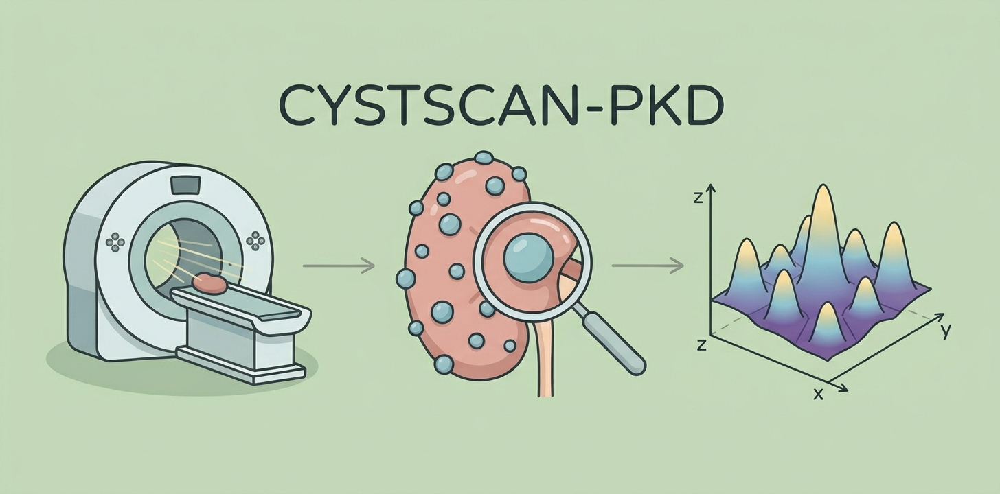

<p align="center">
  
</p>

# CYSTSCAN-PKD

[](https://github.com/Istituto-Mario-Negri-Medical-Imaging/CYSTSCAN-PKD/actions/workflows/ci.yml)
[](https://www.python.org/)
[](https://www.mathworks.com/)
[](LICENSE)
[](https://doi.org/10.5281/zenodo.19049543)
[](https://doi.org/10.5281/zenodo.19097241)
[](https://doi.org/10.1038/s41598-026-61818-7)

Automated cyst segmentation and counting in polycystic kidney disease (PKD) microCT scans.

The segmentation pipeline segments kidney and cysts from microCT scans with the nnU-Net framework. The counting algorithm then detects cysts in the segmentation mask by distance-transform peak detection. A genetic algorithm optimised the algorithm's six parameters against manual counts on an Optimization set; performance was measured on a separate Evaluation set against counts from two independent operators.

This repository accompanies the paper:

> *CYSTSCAN-PKD: a comprehensive pipeline for automatic cyst segmentation and counting on µCT scans from PKD animal models*, A. Mangili, A. Arrigoni, F. Sangalli, S. Fest-Santini, D. Corna, D. Cerullo, C. Xinaris, S. Tomasoni, M. Santini, A. Remuzzi, A. Caroli, *Scientific Reports*, 2026. DOI: [10.1038/s41598-026-61818-7](https://doi.org/10.1038/s41598-026-61818-7)

---

## Install

Python 3.10 or later. From a clone of the repository:

```bash
pip install -e .                    # counting only
pip install -e ".[segmentation]"    # + nnU-Net segmentation (PyTorch)
pip install -e ".[analysis]"        # + optimisation, sensitivity analysis and plots
pip install -e ".[test]"            # + pytest and ruff
```

This installs the `cystscan` command and the `cystscan` Python package.

### Docker

```bash
# counting only
docker build -f docker/Dockerfile.cpu -t cystscan:cpu .
docker run --rm -v "$PWD/tests/data:/data" cystscan:cpu count --input-dir /data

# segmentation on an NVIDIA GPU (weights are downloaded into the /models volume at the first run)
docker build -f docker/Dockerfile.gpu -t cystscan:gpu .
docker run --rm --gpus all -v "$PWD/models:/models" -v "$PWD/scans:/data" cystscan:gpu \
    segment --input /data/scan.nii.gz --model n20 --output /data/masks --models-dir /models
```

Pinned dependency versions for the images are in `requirements/lock-cpu.txt` and `requirements/lock-gpu.txt`.
The GPU image is based on `pytorch/pytorch:2.14.1-cuda12.6-cudnn9-runtime` and needs an NVIDIA driver that supports CUDA 12.6 (driver 560 or later).

### Hardware

- **Counting** runs on CPU. It holds several float32 copies of the mask volume in memory: peak memory was about 7 GB for a KRATS mask (about 470 × 510 × 680 voxels) and about 22 GB for an XRATS mask (about 750 × 750 × 1000 voxels), with run times of about 25 s and 90 s per mask on one workstation core.
- **Segmentation** uses nnU-Net v2 (3d_fullres, 5 folds) and needs an NVIDIA GPU with CUDA for practical run times. Each model's weights take about 1.2 GB on disk.

---

## Quick start

Count the cysts in the synthetic test mask shipped with the repository (12 spherical cysts):

```bash
cystscan count --input-dir tests/data
```

Segment a scan and count its cysts:

```bash
cystscan segment --input path/to/scan.nii.gz --model n20 --output masks/ --models-dir models/
cystscan count   --input-dir masks/ --output cyst_counts.csv
```

`cystscan demo` (segmentation and counting on an open test scan) is not available yet.

### Inputs and outputs

- **Scans**: 3-D NIfTI (`.nii` or `.nii.gz`). A scan named `KRATS_024.nii.gz` or `KRATS_024_0000.nii.gz` (nnU-Net channel suffix) gives the case id `KRATS_024` and the mask `KRATS_024.nii.gz`.
- **Masks**: 3-D NIfTI with labels `0` background, `1` kidney, `2` cyst. The counting reads label 2 only; a trailing singleton fourth dimension is ignored.
- **Counts**: printed per case; `--output` also writes a CSV with columns `case_id, cyst_count`.

### Known limits

- The counting works in voxel units and ignores the voxel spacing in the NIfTI header. The published parameters were optimised on the paper's scans; masks at a different resolution need resampling or new parameters.
- The morphological counting degrades above about 350 cysts per kidney.

---

## Data

The dataset is available on Zenodo (access upon request): <https://doi.org/10.5281/zenodo.19049543>

After downloading, extract and place the two folders inside `data/`:

```
CYSTSCAN-PKD/
└── data/
    ├── 1_Segmentation_pipeline/
    │   ├── Dataset1/                    (KRATS scans)
    │   │   ├── Training Set/
    │   │   │   ├── Images/              (20 NIfTI files, *_0000.nii.gz)
    │   │   │   └── Ground Truth/        (20 NIfTI files, label 1=kidney, label 2=cyst)
    │   │   └── Test Set/
    │   │       ├── Images/              (5 NIfTI files)
    │   │       ├── Ground Truth/        (5 NIfTI files)
    │   │       └── Inferences/          (pre-computed masks, one subfolder per model)
    │   └── Dataset2/                    (XRATS scans)
    │       ├── Images/                  (5 NIfTI files)
    │       ├── Ground Truth/            (5 NIfTI files)
    │       └── Inferences/              (pre-computed masks, one subfolder per model)
    └── 2_Cyst_counting_pipeline/
        ├── Optimization set/
        │   ├── Cyst masks/              (10 NIfTI files, label 1=kidney, label 2=cyst)
        │   └── O1_count.xlsx            (manual counts, Operator 1)
        └── Evaluation set/
            ├── Cyst masks/              (10 NIfTI files)
            └── O1_O2_counts.xlsx        (manual counts, Operators 1 and 2)
```

The cyst counting pipeline (MATLAB and Python) reads only the files under `2_Cyst_counting_pipeline/`.
The segmentation pipeline reads raw scans from `1_Segmentation_pipeline/`. Model weights are downloaded automatically from their own open Zenodo record and checked against its md5 checksums; see [Segmentation](#segmentation) below.

---

## Reproducing the paper

The paper's analysis was run in MATLAB, with plots in R. Both are kept in `matlab/`.
The Python pipeline gives the same cyst counts as the MATLAB one on the paper's masks
(see [python/README.md](python/README.md)); [docs/figures.md](docs/figures.md) maps the paper's figures and tables to the scripts.

### MATLAB

**Requirements:** MATLAB R2020b or later with the Image Processing, Statistics & Machine Learning, Parallel Computing, and Global Optimization toolboxes.

```matlab
cd matlab/

% Optimise parameters on the Optimization set
run_optimization

% Evaluate on the Evaluation set
run_evaluation           % uses parameters from the step above
% or
run_evaluation_paper     % uses the published parameters, no optimisation needed
```

For sensitivity analysis and statistical plots, see [matlab/README.md](matlab/README.md).

### Python

```bash
pip install -e ".[analysis]"

# Optimise parameters (the seed makes the run repeatable)
python python/run_optimization.py --seed 42

# Evaluate on the Evaluation set
python python/run_evaluation.py          # uses GA-generated parameters
# or
python python/run_evaluation_paper.py    # uses published parameters
```

The published parameters are stored once, in `cystscan/data/published_params.json`, and read by both the MATLAB and the Python scripts.

### Statistical plots (R)

After running either evaluation script, Bland-Altman and regression plots can be generated in R:

```bash
Rscript matlab/statistical_analysis.R
# or open matlab/statistical_analysis.R in RStudio and run it
```

Requires: `readr`, `ggplot2`, `dplyr`.
An equivalent Python script is available at `python/bland_altman_plots.py`.

---

## Segmentation

The segmentation step (kidney + cyst masks from raw microCT scans) uses pre-trained nnU-Net v2 models.

**Model weights** (~1.2 GB per model) are downloaded automatically from Zenodo
(<https://doi.org/10.5281/zenodo.19097241>) on first use and checked against the md5 checksums listed in the record.

**Raw scan data** for reproducing the segmentation results is available on Zenodo (access upon request)
at <https://doi.org/10.5281/zenodo.19049543> (same record as the dataset above).
Place the downloaded data under `data/1_Segmentation_pipeline/` as shown in [Data](#data).
The `Images/` files carry the nnU-Net suffix `_0000`; pass them as they are.

```bash
pip install -e ".[segmentation]"

# Step 1 – segment a scan (downloads weights on first run, ~1.2 GB)
cystscan segment --input path/to/scan.nii.gz --model n20 --output path/to/output/ --models-dir ./models/

# Step 2 – count cysts in the segmentation mask
cystscan count --input-dir path/to/output/ --output cyst_counts.csv
```

The older module commands (`python -m segmentation.run_inference`, `python -m segmentation.count_cysts`) still work.

Available models: `n5`, `n10`, `n15`, `n20` (2-channel: microCT + Sobel edges), `n5_1C` (1-channel baseline).
See [segmentation/README.md](segmentation/README.md) for module details, or [workflows/segment_kidneys.md](workflows/segment_kidneys.md) for a step-by-step guide.

---

## For developers

### Tests

```bash
pip install -e ".[analysis,test]"
pytest -m "not gpu"
```

These are the tests CI runs. `tests/test_matlab_parity.py` compares the Python counts with the paper's MATLAB counts; it runs only when the Zenodo data are in `data/` and takes several minutes.

### GPU check before a release

Run this before a release and after any update of nnU-Net, PyTorch, CUDA or the GPU image. It segments one scan with the `n5` model end to end and checks the cyst Dice against a manually corrected mask of the same scan (at least 0.80). It needs an NVIDIA GPU, the `[segmentation]` extra and a scan with its reference mask; CI skips it.

```bash
CYSTSCAN_TEST_SCAN=scans/case_0000.nii.gz CYSTSCAN_TEST_REFERENCE=scans/case_mask.nii.gz pytest -m gpu -s
```

A failure means the installation is broken (CUDA, weights, dependencies) or the scan differs from the training data (scanner, resolution); the test cannot tell which. It also prints the cyst count on both masks, without asserting it: the counts in the paper come from manually corrected masks, and the peak-based count reacts to small boundary differences, so a mask with a high Dice can still give a different count.

---

## Repository structure

```
CYSTSCAN-PKD/
├── cystscan/                    (Python package: counting, segmentation, CLI)
├── python/                      (Python analysis scripts: optimisation, evaluation, sensitivity)
├── matlab/                      (MATLAB pipeline and R plots used for the paper)
├── segmentation/                (old module entry points, kept for compatibility)
├── tests/                       (pytest suite and the synthetic test mask)
├── docker/                      (CPU and GPU images)
├── requirements/                (pinned dependency versions for the images)
├── docs/                        (figure-to-script map)
├── tools/                       (maintainer scripts: test fixtures, Zenodo packaging)
├── workflows/                   (step-by-step guides)
├── data/                        (Zenodo data goes here, not in Git)
└── results/                     (created at runtime)
```

---

## Citation

If you use this software, please cite the paper:

```bibtex
@article{mangili2026cystscan,
  title   = {{CYSTSCAN-PKD}: a comprehensive pipeline for automatic cyst segmentation and counting on {$\mu$CT} scans from {PKD} animal models},
  author  = {Mangili, A. and Arrigoni, A. and Sangalli, F. and Fest-Santini, S. and Corna, D. and Cerullo, D. and Xinaris, C. and Tomasoni, S. and Santini, M. and Remuzzi, A. and Caroli, A.},
  journal = {Scientific Reports},
  year    = {2026},
  doi     = {10.1038/s41598-026-61818-7}
}
```

`CITATION.cff` holds the same information for GitHub's "Cite this repository".

## Licence

Apache License 2.0, see [LICENSE](LICENSE).
